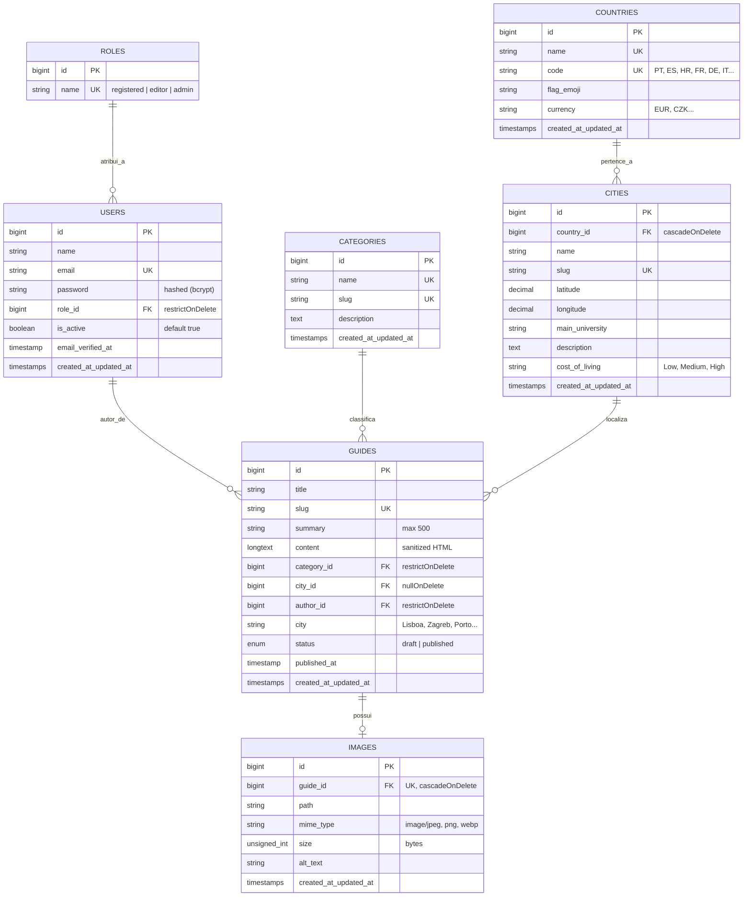

# 🎓 ErasmusHub

> **Design Web Avançado de Serviços Web** &bull; Projeto Semestral  
> **Tema do Seminário:** *The evolution of web development* (A evolução do desenvolvimento web)  
> **Plataforma:** PHP 8.5 / Laravel 11/12 &bull; MySQL &bull; Tailwind CSS &bull; REST API &bull; Open-Meteo API  

---

## 📌 1. Visão Geral do Projeto

O **ErasmusHub** é uma aplicação web completa desenvolvida para apoiar estudantes em mobilidade Erasmus+. A plataforma oferece guias práticos, dicas de sobrevivência académica e urbana, alojamento, transportes, custo de vida e eventos em diversas cidades europeias (ex.: Lisboa, Porto, Coimbra, Zagreb, Split, Madrid, etc.).

A aplicação cumpre integralmente todos os requisitos solicitados na disciplina:
- **Frontend público:** Responsivo, pesquisa dinâmica, filtragem por categorias e cidades, paginação e meteorologia em tempo real.
- **Multilíngue (i18n):** Suporte completo para 3 línguas: **Inglês (EN)**, **Português (PT)** e **Croata (HR)**.
- **Backend robusto:** Desenvolvido em PHP com a arquitetura MVC do Laravel.
- **CMS / Administração de Conteúdos:** Ciclo de vida de guias (rascunhos vs. publicados), editor de texto avançado (Rich Text), upload/remoção de imagens e gestão de categorias.
- **Controlo de Acesso Baseado em Papéis (RBAC):** Visitante, Utilizador Registado, Editor e Administrador, com invalidação imediata de sessão para contas desativadas.
- **Base de Dados Relacional:** MySQL com integridade referencial, restrições `restrictOnDelete` e `cascadeOnDelete`, e transações de banco de dados (`DB::transaction`).
- **API RESTful Própria:** Endpoints documentados com códigos HTTP semânticos (200, 201, 204, 400, 401, 403, 404, 500), validação por **JSON Schema (Draft 2020-12)** e consumo ativo no frontend via JavaScript `fetch()`.
- **Serviço Web Externo:** Integração com a API **Open-Meteo** para obtenção de dados meteorológicos em tempo real com timeout de 3s, cache de 30 minutos e tolerância a falhas.

---

## 👥 2. Perfis de Utilizador e Permissões (RBAC)

| Papel | Descrição | Permissões |
|---|---|---|
| **Visitante** | Utilizador não autenticado | Consulta páginas públicas, lê guias publicados, pesquisa, filtra e consulta a meteorologia. |
| **Utilizador Registado** | Estudante com conta ativa | Acede a conteúdos publicados e gere o seu perfil pessoal (nome, email, palavra-passe). Não pode publicar guias nem aceder ao CMS. |
| **Editor** | Autor de conteúdos | Cria novos guias (rascunho ou publicado), edita e elimina **exclusivamente os seus próprios guias**, faz upload de imagens. Não pode alterar categorias nem gerir utilizadores. |
| **Administrador** | Gestor total da plataforma | Gere todos os guias (de qualquer autor), cria/edita/elimina categorias, gere utilizadores, altera perfis/roles e ativa/desativa contas. |

> 🔒 **Segurança ativa:** Ao desativar uma conta (`is_active = false`), o middleware `EnsureUserIsActive` deteta o estado e termina imediatamente a sessão em curso do utilizador, redirecionando-o para o ecrã de login.

---

## 🔑 3. Contas de Teste Pré-Configuradas

Todas as contas foram criadas via `DatabaseSeeder` com a palavra-passe padrão: `password`.

| Nome | E-mail | Função (Role) | Estado | Propósito de Teste |
|---|---|---|---|---|
| **Admin ErasmusHub** | `admin@example.com` | `admin` | Ativo | Gestão global, categorias, utilizadores e guias |
| **Editor Um** | `editor1@example.com` | `editor` | Ativo | Testar criação e edição dos seus próprios guias |
| **Editor Dois** | `editor2@example.com` | `editor` | Ativo | Testar restrição de acesso aos guias de outros editores |
| **Utilizador Registado**| `user@example.com` | `registered` | Ativo | Testar perfil básico e ausência de poderes no CMS |
| **Conta Desativada** | `inactive@example.com` | `registered` | **Inativo** | Demonstrar bloqueio e encerramento de sessão imediato |

---

## 🗄️ 4. Modelo de Dados e Diagrama ER



### Regras de Integridade:
1. **Proteção de Categorias:** Se uma categoria possuir guias associados, o sistema **bloqueia expressamente a sua eliminação** com uma mensagem amigável ao utilizador.
2. **Exclusão de Imagens:** Ao eliminar um guia, o ficheiro físico em disco é apagado e o registo correspondente na tabela `images` é removido via `cascadeOnDelete`.
3. **Transações:** A criação e atualização de guias e respetivas imagens é encapsulada em `DB::transaction()`.

---

## 🌐 5. Sistema Multilíngue (i18n)

A aplicação dispõe de um alternador visual de idiomas no cabeçalho e suporta 3 línguas:
* 🇬🇧 **Inglês (`en`)**
* 🇵🇹 **Português (`pt`)**
* 🇭🇷 **Croata (`hr`)**

O idioma escolhido é persistido na sessão através da rota `/locale/{locale}` e aplicado em cada requisição pelo middleware `SetLocale`.

---

## 🔌 6. Documentação da API REST Própria (`/api/v1`)

A API segue os princípios RESTful, devolve `Content-Type: application/json` e suporta paginação e filtros.

### Endpoints Disponíveis:

| Método | Caminho | Autenticação | Descrição | Códigos HTTP |
|---|---|---|---|---|
| `POST` | `/api/v1/login` | Pública | Autenticação e emissão de token Sanctum para testes (Postman/Bruno). | `200`, `403`, `422` |
| `POST` | `/api/v1/logout` | Sanctum | Revogação do token ativo. | `200`, `401` |
| `GET` | `/api/v1/destinations` | Pública | Lista de países da UE e respetivas cidades Erasmus. | `200` |
| `GET` | `/api/v1/destinations/{slug}` | Pública | Detalhes da cidade com previsão meteorológica completa a 7 dias. | `200`, `404` |
| `GET` | `/api/v1/guides` | Pública | Lista guias publicados com paginação e filtros (`search`, `category_id`, `city`, `per_page`). | `200` |
| `GET` | `/api/v1/guides/{id}` | Pública | Detalhe de um guia publicado. Rascunhos retornam `404`. | `200`, `404` |
| `POST` | `/api/v1/guides` | Editor / Admin | Criação de um novo guia com validação server-side. | `201`, `400`, `401`, `403` |
| `PATCH` | `/api/v1/guides/{id}` | Autor / Admin | Atualização de um guia existente. | `200`, `400`, `401`, `403`, `404` |
| `DELETE` | `/api/v1/guides/{id}` | Autor / Admin | Eliminação de um guia. Resposta vazia (`noContent`). | `204`, `401`, `403`, `404` |
| `GET` | `/api/v1/categories` | Pública | Lista todas as categorias e contagem de guias publicados. | `200` |
| `POST` | `/api/v1/validate-guide-schema` | Pública | Demonstração e verificação de payload contra o **JSON Schema**. | `200` (válido), `400` (inválido) |

### Exemplo de Resposta `GET /api/v1/guides` (Status 200):
```json
{
  "status": "success",
  "data": [
    {
      "id": 1,
      "title": "Como encontrar quarto em Lisboa",
      "slug": "como-encontrar-quarto-em-lisboa",
      "summary": "Dicas para procurar alojamento sem cair em burlas.",
      "category": { "id": 1, "name": "Alojamento", "slug": "alojamento" },
      "author": { "id": 2, "name": "Editor Um" },
      "city": "Lisboa",
      "published_at": "2026-11-17T18:00:00.000000Z"
    }
  ],
  "meta": { "current_page": 1, "last_page": 1, "per_page": 10, "total": 5 }
}
```

### Validação por JSON Schema (Draft 2020-12):
O esquema formal está localizado em `public/schemas/guide-schema.json`. Pode ser testado diretamente via POST para `/api/v1/validate-guide-schema`.
* **Payload Válido (HTTP 200):**
```json
{
  "title": "Guia de Sobrevivência em Zagreb",
  "summary": "Tudo sobre transporte, custo de vida e segurança em Zagreb.",
  "content": "<p>Zagreb é uma capital acolhedora e segura...</p>",
  "category_id": 1,
  "city": "Zagreb",
  "status": "published"
}
```
* **Payload Inválido (HTTP 400):**
```json
{
  "title": "No",
  "content": "Short"
}
```
*Resposta:*
```json
{
  "status": "invalid",
  "valid": false,
  "errors": [
    "Missing required field: 'summary'",
    "Missing required field: 'category_id'",
    "Field 'title' is too short (min 3 characters)"
  ]
}
```

### Consumo no Frontend:
Na página de Destinos (`/destinations`), a aplicação consome ativamente o endpoint `/api/v1/destinations/{slug}` para obter os dados meteorológicos a 7 dias de cada cidade via JavaScript assíncrono, integrando o resultado diretamente na interface do utilizador.

---

## ⛅ 7. Integração com API Externa (Open-Meteo)

O serviço `App\Services\WeatherService` conecta-se à API aberta **Open-Meteo** para obter o clima em tempo real nas cidades dos guias Erasmus:
- **Resiliência a Falhas:** Timeout configurado para 3 segundos.
- **Cache Inteligente:** Resultados são mantidos em cache por 30 minutos, evitando requisições repetidas à rede.
- **Indicador de Frescura:** A interface apresenta ao utilizador se o dado é dinâmico ou recuperado da cache, exibindo o horário exato da última atualização bem-sucedida.
- **Degradação Suave:** Caso a API externa esteja inacessível ou devolva uma estrutura incompleta, a aplicação não falha e apresenta um componente alternativo com mensagem informativa.

---

## 🔒 8. Requisitos de Segurança Implementados

1. **Hash de Palavras-passe:** Armazenamento com `bcrypt` através de `Hash::make()` e verificação segura no login.
2. **Proteção contra Injeção SQL:** Todas as interações com o banco usam o Eloquent ORM / PDO com binding de parâmetros.
3. **Proteção contra Cross-Site Scripting (XSS):** Conteúdos provenientes de formulários passam por sanitização (`strip_tags`) permitindo apenas elementos seguros, e saídas Blade utilizam `{{ }}` por padrão.
4. **Proteção contra CSRF:** Formulários contêm o token de validação `@csrf`.
5. **Renovação de Sessão:** A sessão é regenerada após o login e terminada de forma segura no logout.
6. **Desativação de Contas:** Contas com `is_active = false` têm a sessão imediatamente revogada no próximo pedido.
7. **Validação de Uploads:** Imagens são validadas quanto ao tipo MIME (`jpeg`, `png`, `webp`) e tamanho máximo (2 MB).
8. **Ocultação de Segredos:** Credenciais sensíveis e chaves de aplicação encontram-se isoladas no ficheiro `.env` (excluído do controlo de versões).

---

## 🚀 9. Instruções de Instalação e Execução

### Pré-requisitos:
- PHP >= 8.2 (com extensões `pdo_mysql`, `curl`, `mbstring`, `openssl`, `intl`)
- Composer >= 2.x
- MySQL ou MariaDB (disponível via Laragon)
- Node.js & NPM

### Passo a Passo:
```bash
# 1. Clonar o repositório e entrar na pasta
cd c:\laragon\www\erasmushub

# 2. Instalar dependências PHP
composer install

# 3. Configurar ambiente
copy .env.example .env
php artisan key:generate

# 4. Criar a base de dados MySQL no Laragon com o nome: erasmushub

# 5. Executar as migrações e seeders
php artisan migrate --seed

# 6. Criar o symlink de armazenamento para as imagens
php artisan storage:link

# 7. Compilar os assets de frontend (Tailwind / Vite)
npm install
npm run build

# 8. Executar os testes automatizados
php artisan test
```

A aplicação fica acessível no navegador em:
`http://erasmushub.test` ou através de `php artisan serve` em `http://127.0.0.1:8000`.

---

## 🧪 10. Testes Automatizados

O projeto inclui uma suite completa de testes automatizados com PHPUnit / Pest:
```bash
php artisan test
```
Resultados obtidos: **46 testes aprovados, 164 asserções, 0 falhas**.
Cenários cobertos:
- Acesso à homepage, about, guias públicos e módulo de destinos europeus.
- Alternância de idioma e persistência em sessão (`en`, `pt`, `hr`).
- Bloqueio de visitantes a guias em rascunho (`draft`).
- Desativação imediata de sessão para contas inativas (`is_active = false`).
- Proibição de exclusão de categoria com guias associados.
- Restrição de editor: não pode editar guias de outros editores.
- Emissão de tokens Sanctum (`POST /api/v1/login`) e revogação.
- Validação de upload malicioso de imagens (MIME type).
- Proibição de auto-despromoção de administradores.
- Respostas JSON semânticas da API v1 (200, 404, 204).
- Validação formal do payload contra o JSON Schema.
- Consulta e previsão meteorológica a 7 dias com cache e tolerância a falhas.
